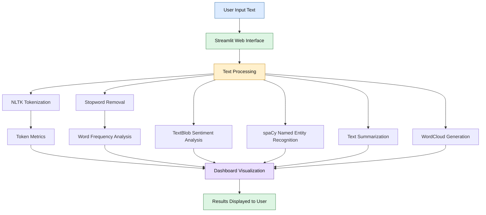
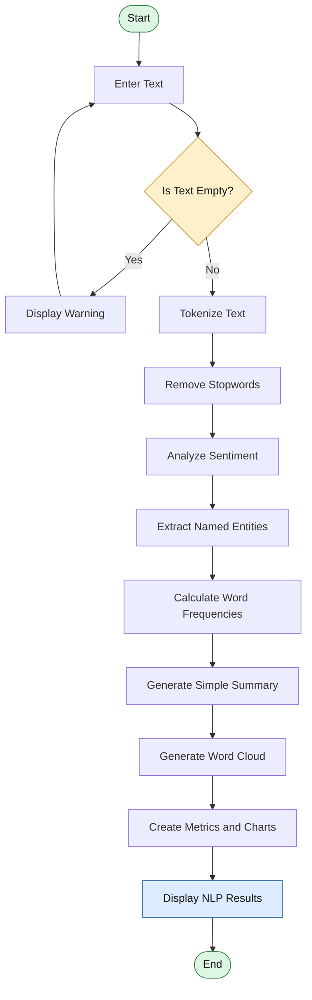

# 🤖 Smart NLP Text Analyzer Dashboard

An interactive **Natural Language Processing (NLP) Dashboard** built using Python and Streamlit to analyze text and extract meaningful insights through NLP techniques and data visualization.

The application transforms user-provided text into useful information using tokenization, stopword removal, sentiment analysis, Named Entity Recognition (NER), word frequency analysis, text summarization, and word cloud visualization.

## 📌 Table of Contents

- [Project Overview](#-project-overview)
- [System Architecture](#-system-architecture)
- [Workflow Diagram](#-workflow-diagram)
- [Features](#-features)
- [Technologies Used](#️-technologies-used)
- [Project Structure](#-project-structure)
- [Installation and Setup](#️-installation-and-setup)
- [How to Run](#-how-to-run)
- [Future Enhancements](#-future-enhancements)
- [Author](#-author)

## 🎯 Project Overview

Natural Language Processing enables computers to process and analyze human language. However, manually understanding large amounts of text can be time-consuming.

This project provides a simple, interactive dashboard that analyzes text and presents results through metrics, tables, charts, and visualizations.

**Objective:** To demonstrate how NLP techniques can be integrated into a single web application for text analysis and information extraction.

## 🏗️ System Architecture

The system follows a modular architecture in which user input is processed by the Streamlit application and analyzed using different NLP libraries. The resulting insights are displayed through an interactive dashboard.



### Architecture Components

| Component | Responsibility |
|---|---|
| User Interface | Accepts text input and displays results using Streamlit |
| Text Processing | Prepares text for analysis |
| Tokenization | Splits text into individual tokens using NLTK |
| Stopword Removal | Removes common English stopwords |
| Sentiment Analysis | Calculates sentiment polarity using TextBlob |
| Named Entity Recognition | Identifies entities using spaCy |
| Word Frequency Analysis | Counts filtered words using Python's Counter |
| Text Summarization | Extracts the first two sentences when available |
| Visualization | Displays metrics, tables, bar charts, and word clouds |

## 🔄 Workflow Diagram

The following diagram shows how the application processes a user's input from start to finish.



## ✨ Key Features

### 1. Tokenization
Splits the input text into individual words and tokens using NLTK.

### 2. Stopword Removal
Removes common English words, such as *is*, *the*, and *and*, to focus on meaningful words.

### 3. Sentiment Analysis
Uses TextBlob to calculate sentiment polarity and classifies the text as:
- Positive
- Negative
- Neutral

### 4. Named Entity Recognition (NER)
Uses spaCy's English language model to identify named entities such as people, organizations, locations, and dates.

### 5. Word Frequency Analysis
Counts the occurrence of filtered words and identifies the top 10 most frequent words. Results are displayed in a table and bar chart.

### 6. Text Summarization
Generates a basic extractive-style summary by selecting the first two sentences when available. This is a simple demonstration rather than an advanced semantic summarization model.

### 7. Word Cloud Visualization
Generates a visual representation of the input text, with word prominence based on frequency.

### 8. Interactive Dashboard
Displays token counts, filtered word counts, named entity counts, unique word counts, and analysis results in a user-friendly interface.

## 🛠️ Technologies Used

| Technology | Purpose |
|---|---|
| Python | Core programming language |
| Streamlit | Web application and dashboard |
| NLTK | Tokenization and stopword removal |
| spaCy | Named Entity Recognition |
| TextBlob | Sentiment polarity analysis |
| Pandas | Tabular data handling |
| Matplotlib | Bar chart visualization |
| WordCloud | Word cloud generation |

## 📂 Project Structure

```text
Nlp-Text-Analyzer/
│
├── app.py
├── README.md
├── requirements.txt
└── .gitignore
```

*Note: Replace `app.py` with the actual name of your Python application file if it differs. Other files may be included depending on your project setup.*

## ⚙️ Installation and Setup

### Prerequisites

- Python 3.9 or a compatible version for the installed dependencies
- Git
- Internet connection for installing packages and downloading the spaCy model

### Step 1: Clone the repository

```bash
git clone https://github.com/prathu-24/Nlp-Text-Analyzer.git
```

### Step 2: Navigate to the project directory

```bash
cd Nlp-Text-Analyzer
```

### Step 3: Install dependencies

```bash
pip install -r requirements.txt
```

### Step 4: Download the spaCy model

```bash
python -m spacy download en_core_web_sm
```

### Step 5: Run the application

```bash
streamlit run app.py
```

Open the local URL displayed in the terminal to access the dashboard.

## 📊 Expected Output

The application displays:

- Dashboard metrics for tokens, filtered words, named entities, and unique words
- Tokenized and filtered word lists
- Sentiment classification and polarity score
- A table of detected named entities
- A basic text summary
- A top-word frequency table and bar chart
- A word cloud visualization

## 🔐 Limitations

- Sentiment analysis uses a basic polarity score and may not fully understand sarcasm or complex context.
- Named entity recognition depends on the capabilities of the pretrained spaCy model.
- Summarization selects sentences based on position rather than semantic importance.
- The application currently focuses on English text.
- Results depend on the quality and length of the supplied text.

## 🚀 Future Enhancements

- Integrate transformer-based models such as BERT for contextual sentiment analysis.
- Implement advanced text summarization using transformer models.
- Support multilingual text analysis.
- Add downloadable PDF or CSV analysis reports.
- Introduce interactive visualizations and improved error handling.
- Allow users to upload text documents for analysis.

## 👨‍💻 Author

**Pratham Kashyap**

GitHub: [@prathu-24](https://github.com/prathu-24)

Project Repository: [NLP Text Analyzer](https://github.com/prathu-24/Nlp-Text-Analyzer)

---

⭐ If you find this project useful, consider giving the repository a star!
